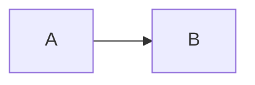

# Code rendering examples

## Example 0

```js
const answer = 42;
```

## Example 1

```ts
// A comment
export function copyText(value: string): string { return value; }
```

## Example 2

```json
{"enabled":true}
```

## Example 3

```yaml
enabled: true
```

## Example 4

```toml
enabled = true
```

## Example 5

```bash
printf hello
```

## Example 6

```python
print("hello")
```

## Example 7

```css
a { color: inherit; }
```

## Example 8

```html
<p>Hello</p>
```

## Example 9

```text
a plain code block
```

## Example 10

```diff
-before
+after
```

## Example 11




Nested content:

- List item with **bold** text.

> Quoted paragraph.
